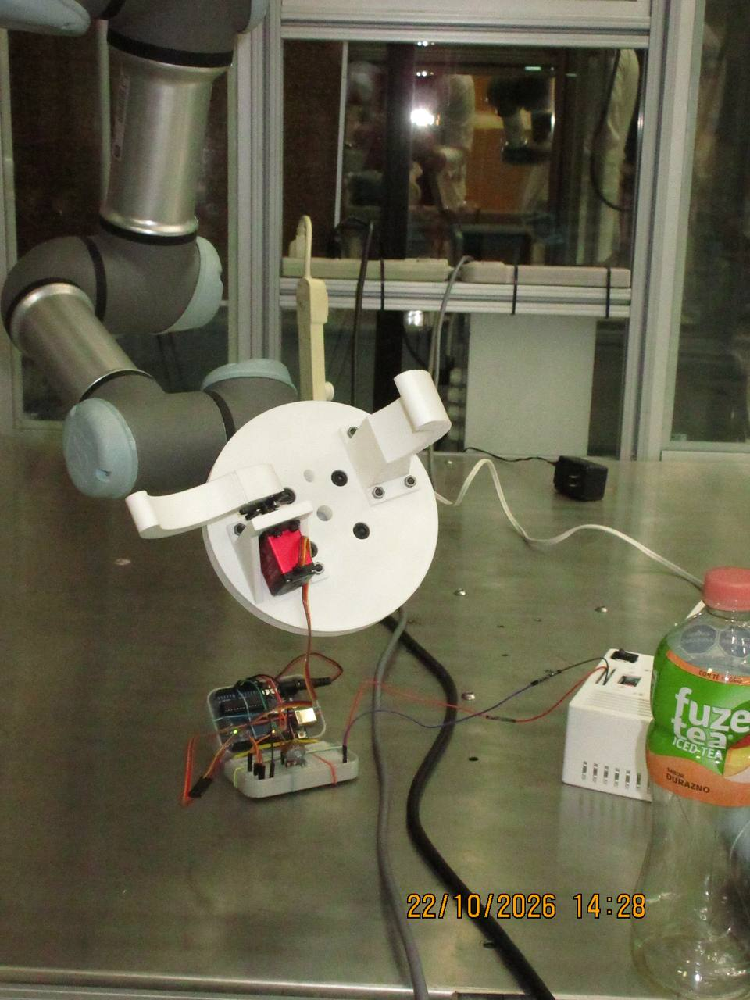
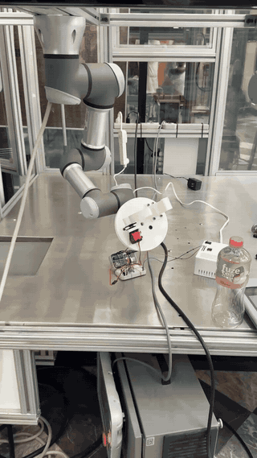
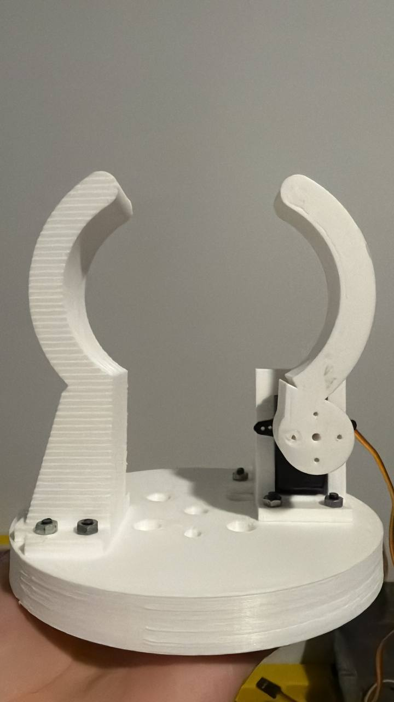
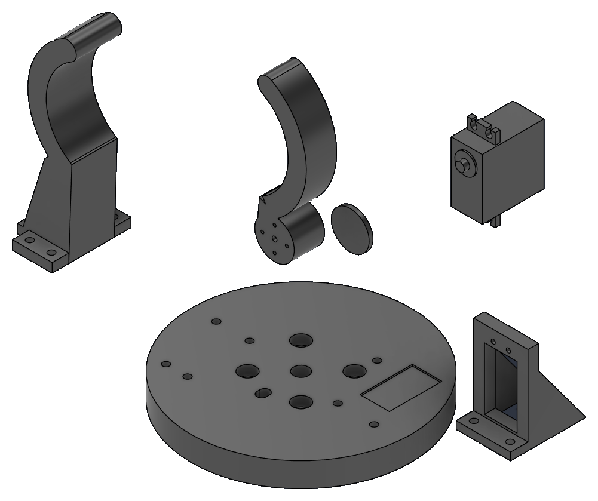

# PET Bottle Gripper for UR3e

A 3D-printed two-finger gripper for a Universal Robots **UR3e** arm, built to pick PET bottles out of mixed recyclables. A U-shaped fixed finger centers the bottle and a servo-driven moving finger closes on it. It bolts straight onto the robot's ISO 9409-1-50-4-M6 tool flange and runs on its own electronics (Arduino Uno, 24 V supply stepped down to 6 V).

<p align="center">
  
  
  
</p>

Results: 10 of 10 successful grips with an empty 600 mL bottle (Ø65 mm) and 10 of 10 with an empty 1 L bottle. Everything in this repo is the version that was actually built and tested.

## Repository layout

```
gripper/             STEP of the 4 printed parts + 00_Ensamble.step (assembled position)
images/              photos, CAD views and the system block diagram
```

File names are in Spanish (*base* = base, *dedo fijo / móvil* = fixed / moving finger, *soporte servo* = servo mount).

<p align="center"></p>

## Printed parts

Printed in PLA on a Creality Ender-3 (0.4 mm nozzle, 205 °C, bed 60 °C). Total about 273 g of filament and 33 h of printing.

| File | BOM ID | Part | Layer | Walls | Infill | Supports | Brim |
|---|---|---|---|---|---|---|---|
| `01_Base` | 01 | Base / flange plate, Ø145 × 16 mm | 0.28 mm | 5 | 40 % | auto | 5 mm |
| `02_Dedo_Fijo` | 02 | Fixed finger (right half of the U) | 0.20 mm | 3 | 40 % | auto | 5 mm |
| `04_Soporte_Servo` | 03 | Servo mount | 0.20 mm | 5 | 60 % | auto | none |
| `07_Dedo_Movil` | 06 | Moving finger (left half of the U, hub fits the servo horn) | 0.20 mm | 5 | 40 % | auto | 5 mm |

The file names come from the CAD model and the BOM below uses a different numbering, hence the two ID columns.

## Bill of materials

Prices are Mexican retail prices from October 2026, for reference.

| ID | Item | Qty | Notes | Approx. MXN |
|---|---|---|---|---|
| 04 | Servo YIMU TD-8125MG | 1 | Digital, 25 kg·cm, 4.8–7.4 V, 180°, metal gears | 214.20 |
| 05 | Servo horn | 1 | Round horn included with the servo | — |
| 07 | M6 × 16 socket head screw, class 8.8 | 4 | Base to UR3e flange, 8 N·m | 8.00 each |
| 08 | M4 × 20 screw + nut | 7 | Fixed finger (4) and servo mount (3) to the base; nuts sit in hex pockets under the base | 5.56 each |
| 09 | M3 × 10 self-tapping screw | 4 | Servo ears to the servo mount | 8.60 each |
| 10 | Power supply S-48-24 | 1 | 100–240 V AC in, 24 V DC 2 A out | 789.50 |
| 11 | XL4015 step-down module | 1 | Set to 6 V for the servo | 119.00 |
| 12 | Arduino Uno | 1 | | 159.00 |
| 13 | Electrolytic capacitor 1000 µF, 25 V | 1 | Across the regulator output | 4.00 |
| 14 | Potentiometer 10 kΩ, linear | 1 | Manual control knob | ~15.00 |
| 15 | 22 AWG wire and Dupont jumpers | 1 lot | | 59.00 |
| 16 | 9 V battery with clip | 1 | Powers the Arduino | 56.00 |

## Wiring

```
AC mains ──────► S-48-24 ──24 V──► XL4015 IN
                                   XL4015 OUT (6 V) ──┬──► servo +  (red)
                                                      ├──► 1000 µF capacitor
                                   XL4015 OUT −   ────┴──► servo −  (brown) ──► Arduino GND  (common ground)

9 V battery ──► Arduino VIN / GND
Servo signal (orange) ──► Arduino pin 9
Potentiometer: outer legs ──► Arduino 5V and GND, wiper ──► A0
```

Set the XL4015 output to 6 V with a multimeter **before** connecting the servo (the servo is rated up to 7.4 V and the supply gives 24 V). See `images/architecture.png` for the block diagram.

## Assembly

1. Print the four parts.
2. Press the seven M4 nuts into the hex pockets on the underside of the base.
3. Bolt the fixed finger (4 × M4 × 20) and the servo mount (3 × M4 × 20) to the base.
4. Fix the servo in its mount with the 4 × M3 × 10 self-tapping screws.
5. Screw the round horn to the hub of the moving finger, but don't put it on the servo shaft yet.
6. Command the servo to 180° (500–2500 µs pulse range), then press the horn onto the servo spline with the moving finger closed, fingertips touching. At 67° the gripper should be fully open without hitting anything; those are the open and closed positions used on the prototype.
7. Bolt the base to the UR3e tool flange with 4 × M6 × 16 (8 N·m). The base has a slot for the flange's Ø6 locating pin and a Ø10 center bore.

## Control

The prototype ran on an Arduino Uno with the standard `Servo` library: in manual mode the potentiometer sets the finger angle between 67° (open) and 180° (closed), moving 1° every 8 ms for a smooth motion; pressing the Uno's RESET button toggles a demo mode that loops open, close, hold and release.

## Limitations

- The gripper is mounted on the UR3e mechanically but is not connected to the robot controller. The Arduino drives it on its own.
- There is no grip sensing. The hobby servo gives no position or current feedback, so when it closes on a bottle it keeps pushing (stalled) until it is opened again.
- This is a simplified prototype of a larger concept: Fin Ray TPU fingers, rack-and-pinion drive, ESP32 with current-based grip control, an RGB status LED and an overhead camera with YOLO to sort PET, aluminum and cardboard.

## License

[MIT](LICENSE)
